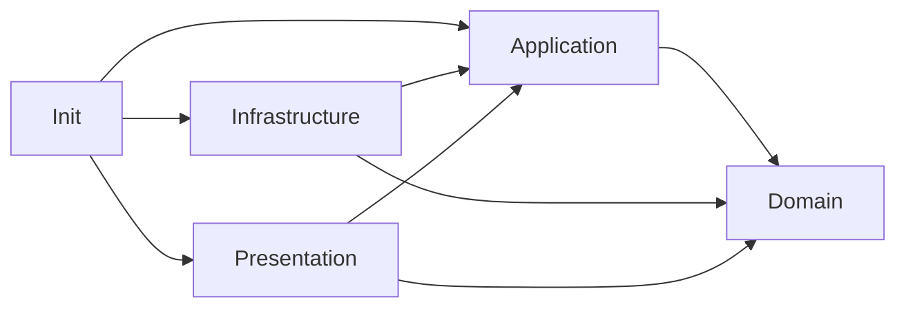

# План разделения фич на слои

Статус: предложение для обсуждения, не новая обязательная конвенция.
Основание: анализ исходного кода на коммите `bf7717e`, 9 октября 2026 года.
Игровой код, сцены, префабы и действующие архитектурные правила этим планом
не изменяются. Выводы получены статическим просмотром, а не профилированием
или проверкой поведения игры в запущенной сцене.

## Рекомендация

Сохранить `Contexts → Features`, но вводить слои выборочно. У каждой фичи
должны быть понятные зависимости; наличие всех четырёх папок необязательно.
Главная цель — отделить решения от выполнения через Unity/Fusion, а не
пересортировать Services, Systems и Components по новым названиям.

Наибольший ожидаемый выигрыш: `Enemy`, `Movement`, `MovementSimulation`,
затем `Input` и активный `Player`. Безопасный первый пример для проверки
конвенции — `LocalSave`: сервис уже работает через контракты хранилищ
и сериализаторов. Маленькие фичи и технические адаптеры не нуждаются
в искусственных Domain и Application. Legacy-контекст `Prototype` не мигрировать.

Инвентаризация: 28 папок фич, из них 27 содержат C#-код; `ApplicationFlow`
содержит только структуру папок и `.meta`. Две реализации принадлежат legacy
`Prototype`. Число файлов ниже включает feature entry и entity installers,
но не контекстные тесты, ассеты, Shared и context Scripts.

## Что считать слоем

| Часть | Содержание | Что не должно попадать сюда |
| --- | --- | --- |
| Domain | Правила конкретной игровой возможности, допустимые состояния, вычисления и инварианты | MonoBehaviour, Transform, Physics2D, Fusion, Zenject, UnityEditor, ScriptableObject и UniTask |
| Application | Сценарий, координация, порт к внешней возможности, входные и выходные данные сценария | NetworkRunner, DiContainer, конкретные компоненты сцены, создание VisualElement |
| Infrastructure | Выполнение через Unity, Fusion, файловую систему, сериализатор, системные API; преобразование внешних данных | Решения, которые можно выразить независимо от механизма выполнения |
| Presentation | Представление, ввод через UI, анимация, камера, HUD, состояние окна и presenter/controller | Правила выбора цели, применения способности или сетевого авторитета |
| Init | Feature, FeatureGroup, Installer и связывание конкретных реализаций с контрактами | Самостоятельная цепочка запуска или игровая логика |

Не любой обычный C#-класс является Domain: NTP-клиент и файловое хранилище
остаются Infrastructure. Не любой MonoBehaviour является Presentation:
сетевой root, источник Input System и физическое тело — Infrastructure.
Controller, управляющий окном, относится к Presentation, даже если он
не наследуется от MonoBehaviour.

Для технических Template-фич Domain обычно отсутствует. Чистый парсер,
история навигации или логика выбора хранилища могут жить в Application;
ради них не нужно изобретать игровой домен.

Базовое направление зависимостей исходного кода:



Прямое использование простых доменных данных в Presentation допустимо;
создавать промежуточный сервис только ради передачи этих данных не нужно.
Infrastructure и Presentation связываются через контракты или Init, без
обязательной зависимости их конкретных реализаций друг от друга.

## Ограничения, которые надо определить до миграции

1. **Namespace не меняет роль.** Сохраняем `ProjectCore.<Context>` и `Shared`.
   `Feature/Scripts/Domain` не означает возвращение namespace `Domain`.
   Zenject Context — граница композиции и времени жизни, а не автоматически
   bounded context из DDD.
2. **Domain — .NET без SDK.** Unity Vector2/Mathf нельзя называть независимым
   Domain. В первом примере используем простые числа и данные. Для movement
   отдельно сравниваем математические типы .NET и адаптацию Vector2;
   не заменяем всю математику проекта ради единообразия. Пока типы Unity
   остаются внутри вычислений, это осознанная зависимая симуляция, а не
   завершённое выделение чистого ядра.
3. **UniTask в Application.** Предлагается оставить UniTask для существующих
   async workflows: это прагматическая уступка независимости от библиотек,
   а не полностью независимый Application. Domain остаётся синхронным и
   чистым. Переход всех контрактов на Task/ValueTask — отдельное решение,
   которое сейчас не даёт доказанной пользы.
4. **Контракты принадлежат потребности.** SDK-независимый порт сценария
   располагается в Application, порт доменного алгоритма — в Domain, если
   он действительно нужен. Fusion-specific контракт остаётся Infrastructure;
   его нельзя протащить в Application под видом интерфейса.
5. **Межфичевые зависимости тоже проверяются.** `Enemy.Application` не может
   обращаться к `NetworkEntities.Infrastructure` через конкретный registry.
   Для нужного чтения создаётся узкий порт/адаптер, а не копия всего registry.
6. **Состояние симуляции принадлежит одному источнику.** Извлечение правил не
   создаёт параллельную изменяемую модель, расходящуюся с `[Networked]`.
   Вход ядра — снимок данных текущего тика; выход — решение/изменения,
   применяемые сетевым адаптером. Сохраняем authority, prediction, rollback,
   tick timers и порядок обхода сущностей. Само наличие Domain не обеспечивает
   детерминизм.
7. **Editor — внешняя часть.** Реальные папки `Editor` и UNITY_EDITOR остаются
   обязательны. Инструменты редактора могут видеть конфигурацию, представление
   и композицию; runtime-код не зависит от Editor.
8. **Конфигурация и ресурсы.** ScriptableObject остаётся Infrastructure/Configs.
   Чистые параметры создаются на границе только там, где нужны ядру.
   DataResources/GraphicResources остаются у фичи; ассеты не раскладываем
   по папкам слоёв исходного кода.

## Разбор по контекстам

Оценки «высокая/средняя/низкая» — качественный прогноз читаемости и
тестируемости по текущему коду, не измеренная экономия времени разработки.
Сложность указана для содержательного выделения границ, а не одного переноса.

### Project

Собственных папок фич нет. `ProjectContextInstaller` устанавливает фичи
из Template: Logging, CommandLine, DebugToolsFeatureGroup, LocalConfig,
AppTime, ObjectFactory, LoadingScreen, SceneLoadingScreenBridge, LocalSave,
SceneFlow. DebugToolsFeatureGroup включает Cheat, DebugVisualization,
DebugConsole и DebugTools.

Разбирать их повторно как Project-фичи не нужно: место владения кодом и
контейнер установки различаются. Context installer и initializer остаются
композицией; отдельные Domain/Application для самого Project не требуются.

### Preloader

| Фича | Сейчас | Предлагаемые границы | Польза и цена | Решение |
| --- | --- | --- | --- | --- |
| ApplicationInitialization — 4 файла | ApplicationEntryPoint запускает ApplicationInitializationFlow; flow задаёт frame rate/sleep timeout, вызывает инициализаторы и SceneFlow | Application: порядок Project → Preloader → первая сцена; Infrastructure: Unity host settings; Init: Feature и entry point | Средняя польза: порядок запуска читается отдельно от платформенных настроек. Но flow принимает BaseSceneDefinition, связанный с Unity-ассетом: один перенос не делает его чистым. Domain отсутствует | Маленький второй этап после базовой конвенции; новый host-settings сервис нужен только при реальной развилке поведения |

Preloader также устанавливает Template/ObjectFactory; это не отдельная
реализация фичи в Preloader.

### GameCore

| Фича | Сейчас | Предлагаемые границы | Польза и цена | Решение |
| --- | --- | --- | --- | --- |
| CameraTarget — 5 файлов | Registry выбирает текущую ICameraTarget и публикует событие; контракт отдаёт Transform; компонент регистрирует цель | Application: выбор текущей цели и события, если появится независимый сценарий; Infrastructure: регистрация Unity target. Допустим пока единый небольшой адаптер | Низкая: registry уже короткий и понятный. Изолировать Transform означает новый снимок/порт позиции и изменения LocalCamera. Полная модель камеры не нужна | Оставить компактной; разделять вместе с изменением потребностей камеры |
| Combat — 7 файлов | DamageableSystem и DamageSourceSystem делегируют поиск/обход компонентов в IGameEntityComponentAccessor; базовые компоненты задают Unity/Fusion-интеграцию | Пока Infrastructure + Init. Domain появится с фактическими правилами урона, сопротивлений, смерти и т. п.; Application — с их применением | Сейчас низкая: отдельного расчёта урона в этих системах нет. Domain с пустым Health/Combat агрегатом был бы спекуляцией | Не начинать с Combat; вернуться при развитии реальных правил |
| Input — 11 файлов | LocalInputProvider читает Input System; InputBufferController использует NetworkRunner/TickTimer; модель буфера хранит сетевое состояние | Infrastructure: Input System, Fusion timers и сериализуемое состояние; Application: захват/потребление команды; чистая политика допуска/просрочки — по необходимости | Средняя/высокая: станет видно отличие ввода человека и обработки команды тика. Цена: буфер связан с rollback и сетевыми таймерами, его нельзя заменить несинхронизированным локальным state | Разделять в связке с movement; сначала описать семантику буфера и времени |
| Movement — 22 файла | Процессоры locomotion/dodge/dash содержат решения, используют ScriptableObject-конфиги и Vector2; BaseMovementStateMachine наследует сетевую state machine; MovementSystem — фасад component accessor | Domain: правила переходов и расчёт действия после изоляции данных; Application: шаг обработки команды; Infrastructure: сетевые states, таймеры, SO и запись velocity | Высокая: отличим правило движения от способа его запуска. Высокая цена: контракты таймеров и тело движения пересекают Input/MovementSimulation/NetworkEntities | Основная миграция после первого примера; не считать MovementSystem доменным только из-за имени |
| MovementSimulation — 13 файлов | MovementSimulationService вычисляет displacement через IMovementCollisionStrategy; LevelCollisionService делает Physics2D casts/overlaps; TransformMovementBodyComponent применяет результат | Domain/вычислительное ядро: шаг симуляции; Application — только если есть отдельный orchestration; Infrastructure: Physics2D, Transform и CollisionMask | Высокая при небольшой границе: strategy уже выделена. Для строгого ядра нужно убрать Vector2/LayerMask из его контрактов. Полный абстрактный физический движок будет избыточен | Второй содержательный кандидат; менять вместе с movement-контрактами |
| NetworkEntities — 24 файла | Factory/spawner/provider работают с Fusion и Zenject; registry хранит BaseNetworkEntityRoot; есть чистые ID/type data | Infrastructure + Init; при необходимости Application-порт для чтения снимков/сущностей. ID остаются у владельца возможности, не автоматически в Shared/Domain | Средняя для потребителей, низкая от четырёх слоёв внутри самой фичи. INetworkBehaviourAccessor возвращает NetworkBehaviour, поэтому не является чистым портом | Выделять узкие порты по запросу Enemy/Movement; большую часть оставить явно Fusion-инфраструктурой |

GameCoreFeatureGroup — композиция, а не ещё одна игровая фича. Он
устанавливает NetworkEntities, CameraTarget, MovementSimulation, Movement,
Combat; Input устанавливается сценой отдельно.

### TechnicalPrototype

| Фича | Сейчас | Предлагаемые границы | Польза и цена | Решение |
| --- | --- | --- | --- | --- |
| Enemy — 51 файл | Выбор и смена цели, steering, способности и dash, две state machines, сетевой root, spawn/cheat/debug компоненты | Domain: выбор направления и условия способности/переходов; Application: обработать AI tick и сформировать команду; Infrastructure: registry queries, Fusion state, prefab/abilities configuration/spawn; Presentation: debug rendering | Наибольшая польза: игровой алгоритм сейчас читается через компоненты и сеть. Высокая цена: нужны снимки соседей/целей и сохранение порядка симуляции; не все state-классы можно просто переместить | Главный кандидат для содержательного разделения, по одному поведению за этап |
| LocalCamera — 3 файла | Component выполняет follow, zoom, ограничения уровня через Camera, Transform, renderer/colliders и LateUpdate | Presentation + Init. Математику ограничения viewport можно вынести в локальный вычислитель, если это помогает тестированию | Низкая: камера является представлением; четыре слоя усложнят навигацию. Локальный математический helper не требует игрового Domain или отдельного use case | Сохранить компактной; только убрать лишнюю ответственность при росте |
| Player — 29 файлов | Network root содержит state/timers/input buffer/facing; Input System/Fusion input и movement states; Animator и mediator/debug | Domain: facing и решения действий, где есть независимое правило; Application: обработка команды тика; Infrastructure: Fusion state/input/spawn и связи компонентов; Presentation: Animator/debug/presenter | Высокая/средняя: будут видны input → решение → network state → animation. Зависимость от Movement/Input делает раннюю изолированную миграцию дорогой | После выделения общих movement/input границ; текущий Animator уже достаточно узкий |

Сценовый installer также устанавливает Template ScreenNavigation и Popup,
GameCoreFeatureGroup и ObjectFactory. При выделении Enemy/Player нужно
проверять как scene container, так и GameObjectContext entity installer:
EnemyTargetingService и EnemySteeringService связываются в entity installer,
а не только в EnemyFeature.

### Template

| Фича | Сейчас | Предлагаемые границы | Польза и цена | Решение |
| --- | --- | --- | --- | --- |
| ApplicationFlow — 0 файлов | Пустая структура с `.meta`; рабочий startup живёт в Preloader/ApplicationInitialization | Никаких новых слоёв | Польза отсутствует. Создание Domain/Application увековечит пустой остаток структуры | Отдельно проверить необходимость и удалить пустой остаток при согласованной чистке |
| AppTime — 6 файлов | AppTimeService выбирает provider; LocalTimeProvider и NtpTimeProvider дают UTC, NTP делает sockets и fallback | Application: сервис и ITimeProvider; Infrastructure: системные часы/NTP; Init | Небольшая/средняя: граница уже естественная. Ни Domain, ни Presentation не нужны; не путать UTC с simulation tick | Лёгкая миграция; не отдельный большой рефакторинг |
| Cheat — 19 файлов | Service объединяет регистрацию, reflection discovery, parsing, conversions, invocation и async-result adaptation | Application: регистрация/исполнение команд и политика доступности; Infrastructure: reflection invoker/сканирование и адаптация handlers; parser/data остаются локальными чистыми деталями | Средняя: проще читать жизненный цикл команды и тестировать ошибки. Reflection — технический механизм даже без Unity; Domain команды игры здесь не появляется | Делить по обязанностям при работе над Cheat, без слоя на каждый utility |
| CommandLine — 9 файлов | Parser/data чистые; provider читает Environment; service подписывается на Console.CancelKeyPress в UNITY_SERVER и использует main-thread context | Application: parsed snapshot и доступ; Infrastructure: environment/cancel signal dispatch; Init | Средняя/небольшая: уже есть provider. Application не станет платформонезависимым, если Console callbacks останутся внутри сервиса | Лёгкая миграция; Domain отсутствует |
| DebugConsole — 16 файлов | System хранит logs/history и исполняет cheats; Controller управляет UI, фильтрами и performance sampling; widgets рисуют | Application: history/command execution; Presentation: controller/view/widgets и состояние окна; Infrastructure: Unity log/profiler/time sampling adapter | Высокая для читаемости controller: он длинный и смешивает UI с метриками. System-Controller-View уже хорошая основа; Domain не нужен | Приоритет среди UI-фич; сначала вынести sampler, а не размножать pass-through use cases |
| DebugTools — 10 файлов | Service вычисляет build availability и enabled state из SO/CLI; группа объединяет инструменты; есть editor window | Application: enable/availability policy по обычным данным; Infrastructure: SO/platform build facts; Presentation/Editor: окно; Init: feature/group | Средняя: будет яснее, где решение доступности, а где build configuration. До разделения нужно убрать SO-зависимость из service | После DebugConsole или при развитии debug policy; без игрового Domain |
| DebugVisualization — 31 файл | Registry держит Unity Object и reflection cache; System создаёт runner/host; runner рисует и собирает HUD; facade передаёт команды | Infrastructure: lifecycle, registry/reflection/backend; Presentation: rendering/HUD; Application — только для реально независимой фильтрации/координации | Средняя: различим сбор данных и показ. Высокая стоимость попытки сделать весь drawing API чистым — Vector/Color/Object здесь естественны | Прагматическое отделение backend от HUD; не обязательное чистое ядро |
| LoadingScreen — 18 файлов | System одновременно управляет состоянием и создаёт/монтирует VisualElement по SO definition/catalog | Application: show/hide lifecycle, если выделяется независимо; Presentation: hosts/views; Infrastructure: SO catalogue/layout creation; Init | Средняя только при изменении контрактов. Текущий System держит Component/VisualElement, простой перенос в Application создаст ложную границу | Решать вместе с Popup/ScreenNavigation после доказательства нужды в headless policy |
| LocalConfig — 7 файлов | Service индексирует BaseLocalConfig SO; lookup parent использует Zenject injection annotation; public generic API ограничен BaseLocalConfig | Infrastructure + Init; независимый lookup engine возможен, но необязателен | Низкая: текущая обязанность именно Unity-конфиги с контекстным fallback. Application-обёртка не уберёт зависимость API от SO | Сохранить компактной; для игровых правил делать SO → plain settings на границе потребителя |
| LocalSave — 19 файлов | Service координирует Save/Load/Exists/Delete через ILocalSaveStorage/Serializer; implementations используют files, PlayerPrefs, JSON и secure storage | Application: service, descriptors, operation DTO/errors и порты; Infrastructure: storages/path provider/serializer; Init | Высокая при умеренной цене: существующие контракты уже скрывают механизм. Domain и Presentation отсутствуют. UniTask остаётся оговорённой библиотечной зависимостью | Рекомендуемый первый пример конвенции и проверки направлений |
| Logging — 8 файлов | DebugLogger пишет Unity Debug; LogService подписан на Application.logMessageReceived; ILogHandler принимает Unity LogType | Infrastructure + Init; независимый logging порт добавлять только когда его требует внутренний слой | Низкая от четырёх папок: это тонкая интеграция. Для ядра достаточно узкого порта либо публикации диагностического результата, не все Domain-объекты должны логировать | Оставить технической; при необходимости заменить LogType на локальные данные в чистом порте |
| ObjectFactory — 4 файла | ClassFactory оборачивает DiContainer, создаёт injected объекты/префабы и предоставляет binding API | Infrastructure + Init | Низкая: это механизм DI. Перенос IClassFactory в Application не очищает CreateMonoBehaviour/Transform и container bindings | Не строить Domain/Application вокруг фабрики; сценариям при необходимости давать предметные factories |
| Popup — 17 файлов | System совмещает stack/lifecycle/completion и создание layouts; IPopupSystem имеет generic constraint на BasePopupView | Presentation + Infrastructure + Init; отдельная Application policy только после введения независимого request/response contract | Средняя при настоящем выделении lifecycle, низкая от механического переезда. Pure Application нельзя ограничить BasePopupView. Собственная Domain-модель popup не нужна | Совместное решение с экранной навигацией; допускается оставлять UI framework во внешних слоях |
| SceneFlow — 13 файлов | Service выполняет exit/load/init/show-hide/finally; напрямую зависит от ZenjectSceneLoader и SO scene definitions | Application: transition orchestration; Infrastructure: loader, payload binding, definition mapping и lifecycle resolution; Presentation: через уже имеющийся ISceneTransitionPresenter | Высокая: станет видно, где порядок перехода, а где Zenject/Unity. Высокий риск lifecycle regression; отмена/ошибки/cleanup должны остаться прежними | Позднее, отдельным этапом с startup/play проверками |
| SceneLoadingScreenBridge — 2 файла | Feature связывает ISceneTransitionPresenter с adapter к ILoadingScreenSystem | Infrastructure + Init либо сохранить компактный adapter | Низкая: граница уже есть, бизнес-правил и собственного сценария нет. Application-pass-through добавит переход по файлам | Оставить компактной; четыре слоя не вводить |
| ScreenNavigation — 15 файлов | System управляет history и VisualElement/layout creation; IScreenNavigationSystem ограничивает TScreen через BaseScreenView | Presentation/Infrastructure + Init; Application: независимая история/переходы лишь после изменения API | Средняя: можно отдельно понимать history. Но перестройка generic constraints и definition/history data — содержательная смена контракта, не сортировка файлов | Рассматривать вместе с Popup/LoadingScreen; без отдельного Domain |

### Prototype — legacy

| Фича | Сейчас | Польза от слоёв | Решение |
| --- | --- | --- | --- |
| Player — 60 файлов | Старый набор climbing/crouch/jump/ground detection, health/damage и Fusion states | Потенциально есть выделяемые правила, но проект запрещает новые runtime-зависимости от legacy-контекста. Перестройка увеличит объём сопровождения старого эксперимента | Не мигрировать. Если алгоритм снова нужен, отдельно перенести проверенную возможность в актуального владельца |
| Prototype — 14 файлов | Старый match/bot/cursor/camera/HUD/popup и запуск HUD через navigation | Слои не устранят смешение экспериментальных обязанностей; инвестиция в неактивную композицию не окупается сейчас | Оставить архивным источником; не использовать как образец будущей структуры |

## Почему одного переноса файлов недостаточно

1. `EnemySteeringService` — обычный C# service, но извлекает concrete
   EnemyNetworkEntityComponent из INetworkBehaviourAccessor, читает Transform
   и NetworkEntityRegistry. Его надо разделить на сбор данных и расчёт
   steering. Название Domain в пути не изменит эти зависимости.
2. `EnemyDashChaseAbilityProcessor` проверяет тип цели через
   PlayerNetworkEntityConstants и читает позицию NetworkBehaviour. При
   выделении правила сначала сохраняем точную семантику «dash только к Player»
   в явном признаке/данных цели; не заменяем её молча на «любая targetable цель».
3. `Movement` содержит и независимые переходы, и сетевую иерархию states.
   BaseMovementStateMachine нельзя считать чистым Domain, пока его базовый
   класс контролирует Fusion authority и network ticks.
4. `NetworkEntityRegistry` не импортирует Fusion напрямую, но хранит
   BaseNetworkEntityRoot. Аналогично интерфейс, возвращающий NetworkBehaviour,
   сохраняет зависимость от SDK. Нужна транзитивная проверка типов.
5. Popup/ScreenNavigation уже имеют interfaces, но constraints завязаны
   на конкретные базовые View. Для чистого Application нужно менять границу
   request/response, а не только using директивы.

## Предлагаемая физическая структура

Пример первой миграции:

```text
Contexts/Template/Features/LocalSave/
  Scripts/
    Application/
      Abstract/           # ILocalSaveService/Storage/Serializer и нужные порты
      Services/           # LocalSaveService
      Data/               # descriptors, operation data/DTO
    Infrastructure/
      Storages/
      Serializers/
      Providers/
    Init/
      LocalSaveFeature.cs
```

Пример более сложной фичи после выделения реальных границ:

```text
Contexts/TechnicalPrototype/Features/Enemy/
  Scripts/
    Domain/               # решения AI/способностей по обычным данным
    Application/          # обработка тика и узкие порты чтения/записи
    Infrastructure/       # Fusion, Unity states, spawn, SO, ability assembly
    Presentation/         # debug renderer / будущая анимация
    Init/                 # feature и entity installer
  DataResources/
  GraphicResources/
```

Создаём только непустые слои. В маленьком слое файлы могут находиться прямо
в корне; тематические подпапки появляются по необходимости. Не воспроизводим
полную лестницу `Layer/Managers/Services` и `Layer/DataHolders/Models` в каждой
фиче. Это предложение изменения текущей закрытой Scripts taxonomy, которое
нужно сначала оформить в CONVENTIONS и валидаторе.

Для совсем маленьких фич допустимо оставить текущую компактную структуру.
Тогда валидатор явно различает компактную и слоистую структуру; внутри одной
фичи не смешиваем две конкурирующие схемы. Решение отмечается в её описании.
Если единообразие папок окажется важнее, техническую фичу можно разместить
целиком в Infrastructure + Init, не добавляя пустые остальные слои.

## Последовательность внедрения

| Этап | Работа | Условие завершения |
| --- | --- | --- |
| 0. Согласовать модель | Выбрать минимальную структуру, правила Domain/UniTask/Editor и отношение к компактным фичам; утвердить карту выше | Правила позволяют разместить каждый существующий тип без искусственного слоя или исключения «потому что это service» |
| 1. Подготовить проверки | Обновить CONVENTIONS, ARCHITECTURE_RULES и валидатор для двух схем; сохранить flat namespaces и существующий lifecycle | Положительный fixture и отрицательные случаи нарушения слоёв проходят ожидаемо; legacy layout временно остаётся валидным для ещё не мигрированных фич |
| 2. LocalSave | Перенос service/ports/данных и implementation storages/serializer; без изменения формата сохранений, public API и поведения | LocalSaveServiceTests проходят; при чтении сценария не нужно открывать storage; Git diff в основном перемещения и документированные зависимости |
| 3. Небольшие границы | AppTime/CommandLine и при необходимости ApplicationInitialization | Видно, где системный источник и где orchestration; нет новых pass-through классов без отдельной обязанности |
| 4. Movement + MovementSimulation + Input | Зафиксировать ownership timers/state и данные на границах; выделять правила и физическую адаптацию по одному изменению | Существующие movement/dodge/input tests проходят; добавлены проверки выделенных правил и meaningful prediction/rollback сценария перед сменой state ownership |
| 5. Enemy | Сначала steering по снимкам, затем выбор/смена цели и dash eligibility, затем orchestration; entity wiring сохраняет поддержку prefab abilities | EnemyTargetingServiceTests/EnemyPrefabTests и проверки выделенных правил; behavior сравнивается с прежним на одинаковых входах; state authority и cooldown не изменились |
| 6. Активный Player | Использовать готовые movement/input границы; разделить input/network/facing/animation | PlayerFacingDirectionProcessorTests/PlayerPrefabTests; ownership и render callbacks не смешаны с правилами шага |
| 7. UI и scene flow | Отдельно решить необходимость чистой UI policy; DebugConsole сначала, SceneFlow позднее; Popup/ScreenNavigation/LoadingScreen проектировать вместе | Проверены cancel, failure, back/history, completion, unload и cleanup; нет цикла Application → concrete View/loader |
| 8. Итоговый пересмотр | Повторно оценить оставшиеся компактные фичи; при необходимости убрать ApplicationFlow; legacy оставить отдельно | Карта актуальна, технические адаптеры не получили пустых слоёв, нет обязательных четырёх папок для всех |

Этапы 3 и 7 необязательно выполнять для каждой перечисленной фичи.
Если приоритет — ближайшее развитие AI, после LocalSave можно начать
выделение одного чистого steering-алгоритма Enemy, не дожидаясь всей movement
миграции. Его более широкая перестройка всё равно зависит от общих контрактов.
Оценки в календарных днях сейчас не обоснованы: масштаб станет понятнее
после проверки конвенции и решения вопроса симуляционного состояния.

## Проверки архитектуры и поведения

Без новых `.asmdef` физические слои не создают границ компиляции. При flat
namespaces недостаточно проверять только using: типы соседних слоёв часто
доступны без using. Валидатор должен сопоставлять владельца типа с путём,
анализировать inheritance, generic constraints и типы signature/member;
сложные случаи требуют семантического анализа C# или ручной проверки.
Не выдавать regex-эвристику за полную гарантию отсутствия зависимостей.

Особенно полезные отрицательные проверки:

- Domain напрямую или транзитивно использует Unity/Fusion/Zenject/UniTask.
- Application зависит от concrete Component/View, registry или SDK API.
- Interface в Application возвращает NetworkBehaviour/Transform.
- Application generic constraint ссылается на Presentation BaseView.
- Возникает межфичевой цикл или runtime-ссылка на Editor/Tests.

Новые тесты добавляются для выделенных правил и рискованных integration
границ, а не для каждого перемещённого файла. Контекстные Tests/Editor и
Tests/Play сохраняют расположение. Реальные доменные правила должны получать
прямые тесты; существующее ограничение касается Shared primitives, а не
будущих игровых моделей.

Для каждого внедряемого этапа: strict architecture validation, runtime build,
git diff --check и подходящие существующие тесты. Для сетевых/scene изменений
нужен запуск Unity-проверок; одного dotnet build недостаточно. При переносах
сохраняются `.meta`, serialized ссылки и единственный initialization flow.

## Как понять, что стало проще

После LocalSave и первой игровой миграции сравнить конкретные задачи:

- Найти правило разрешения dash и понять его, не читая Fusion callbacks.
- Изменить алгоритм steering, не меняя prefab wiring.
- Подменить storage в тесте, не создавая Unity-сцену.
- Найти весь UI lifecycle окна в одной части фичи.
- Проверить, какие файлы нужно открыть для обычного изменения поведения.

Миграция оправдана, если правила стали тестироваться и читаться независимо,
а технические зависимости уменьшились. Если добавились только папки,
дублирующие DTO, forwarding interfaces и переходы между маленькими файлами,
надо упростить конкретную фичу, а не продолжать раскладку ради одинаковости.

Не вводить автоматически DDD aggregates, repositories для каждой сущности,
CQRS/MediatR, event bus на каждый переход или отдельный use case на каждый tick.
Это дополнительные решения, не обязательные последствия Clean Architecture.

## Основания

Анализ опирается на feature entries, контекстные installers, services/systems,
SDK-зависимые контракты и representative state/processor/view реализации.
Особенно показательны EnemySteeringService, EnemyDashChaseAbilityProcessor,
InputBufferController, BaseMovementStateMachine, SceneFlowService,
IPopupSystem, IScreenNavigationSystem и LocalSaveService.

Clean Architecture ориентирована на направление зависимостей, а не число
папок: [Microsoft — Common web application architectures](https://learn.microsoft.com/en-us/dotnet/standard/modern-web-apps-azure-architecture/common-web-application-architectures).
Различие domain rules и application orchestration, а также целесообразность
упрощения для простых возможностей: [Microsoft — Designing a DDD-oriented microservice](https://learn.microsoft.com/en-us/dotnet/architecture/microservices/microservice-ddd-cqrs-patterns/ddd-oriented-microservice).
Эти источники описывают серверные системы; карта Unity-фич выше — вывод
из исходного кода TroughGame, а не готовая рекомендация Microsoft для Unity.
